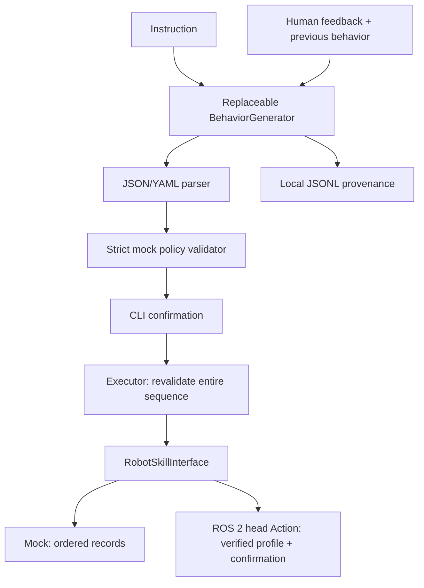

# Architecture



## Packages and boundaries

| Package/module | Responsibility |
|---|---|
| genem_hsr.behavior | parse encodings, reject ambiguity, enforce schema/ranges/time budget |
| genem_hsr.generator | abstract backend, offline fixtures, generic API transport |
| genem_hsr.skills | six explicit abstract methods; mock implementation; profile-gated ROS 2 HSR adapter |
| genem_hsr.executor | validate all steps before invoking any whitelisted method |
| genem_hsr.history | append instruction, plan, feedback, revised plan, UTC timestamp and execution status |
| genem_demo.cli | confirmation, demo selection, revision loop, clean exit status |

This release is a ROS 2 package/CLI integration, not a running ROS graph of separate
publisher/subscriber nodes. Core logic is ordinary Python and can be tested without ROS.
Mock still uses no robot communication; ROS imports are lazy. ROS 2 execution uses standard control_msgs, controller_manager_msgs, sensor_msgs and trajectory_msgs.

## Data contract

```yaml
behavior:
  name: acknowledgement
  sequence:
    - skill: look_at
      parameters: {target: person}
    - skill: head_nod
      parameters: {amplitude: 0.15, speed: 0.5, repetitions: 1}
```

Angles are radians, speed radians/second, duration seconds. `person` is a symbolic
mock target, not a detected person or coordinate transform. Unknown fields, skills,
missing parameters, duplicate keys, YAML aliases/tags, booleans as numbers,
nonfinite numbers and out-of-range values are refused. Input size is bounded.
The limits in `config/mock_limits.yaml` are a documentation mirror; `behavior.py`
is the enforced source of truth, not a configurable hardware policy.

Nod/shake budget is `4 * amplitude * repetitions / speed`, representing a center,
positive excursion, negative excursion and return cycle. Gaze has a fixed 3s mock
estimate; speech uses `2 + len(text)/10`; waits contribute their specified duration.
At most 20 steps and 60s estimated duration. No actual motion trajectory is generated.
Mock does not sleep: durations are validated logical budgets only.

Execution validates a deep copy of the whole plan before the first action. A bad
later step therefore cannot cause partial execution of an otherwise valid prefix.
Skill selection is whitelist-driven; there is no `eval`, `exec` or shell invocation.
ROS execution requires `hardware_confirmed=True` after CLI confirmation, plus a verified profile and live preflight. The executor dispatches a whole-plan trajectory rather than per-skill calls.

## Backends and revisions

`BehaviorGenerator.generate(instruction, previous=None, feedback=None)` is the
extension point. Offline rules accept the five demo instruction types and a small
feedback vocabulary (slow/friend/enthusiastic); unsupported requests are errors.
Over-limit revisions are rejected rather than silently clamped.
API revisions receive original instruction, previous validated plan and feedback.
No invalid API plan falls back to a mock fixture silently.

`APIBehaviorGenerator` sends chat-completions-shaped messages over a generic
`requests` transport (injectable in tests). The provider must support a `model`,
`messages`, and `temperature` request and `choices[0].message.content` response.
A 10s connection timeout / 45s read timeout, HTTPS policy and redirect refusal apply.
No SDK or specific provider/model availability is assumed. Remote usage sends user
instructions and feedback to the configured provider. Credentials come from env only.

CLI execution is synchronous. API failures, malformed plans or disabled hardware
return status 2; user interruption/EOF returns 130. Declining execution is logged.
History is append-only single-process JSONL; no concurrency locking or database.
Do not treat the history as proof of physical robot execution: adapter is recorded as mock, hsr_simulator or hsr_hardware. A successful controller result is not proof of expressive quality.

## ROS 2 motion extension

See [HSR integration](hsr_integration.md). The adapter checks the active controller,
joint set, interpolation, clock and fresh stationary joint feedback. It compiles all
waypoints before side effects, bounds spline velocity/acceleration and actual total
time, monitors the state stream, checks the Action result and final state, and
cancels on interruption or loss of feedback. ROS plans cannot use `--yes`.
The simulator profile also requires a recognized simulation hardware component.
