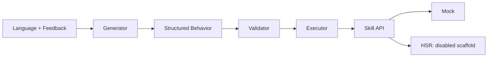

# GenEM-Inspired Expressive Behaviors for Toyota HSR

## 1. Motivation

Expressive actions can communicate attention and acknowledgement during human–robot
interaction. Our research question is whether language-based generation and iterative
feedback can support interpretable, personalized behavior on HSR.

## 2. Original GenEM

[GenEM (Mahadevan et al., HRI 2024)](https://arxiv.org/html/2401.14673v1)
connects language, embodiment-specific planning and parameterized robot programs.
Its feedback mechanism revises behavior according to human preferences.
This prototype is an independent adaptation, not a replication of the reported studies.

## 3. Implementation Goal

Build an inspectable, portable prototype before enabling physical motion. The present
milestone is a complete Mock workflow with explicit hardware integration boundaries.

## 4. Architecture

## 5. Docker Environment

Ubuntu 24.04, ROS 2 Jazzy and Python 3.12 are packaged in an independently buildable
CPU image. Source code and local history are mounted for development. GPU exposure
is optional and untested; it is unnecessary for remote API generation.

## 6. Behavior Generation

The default backend uses deterministic demonstration rules. An interchangeable API
backend requests structured plans from a configured chat-completions-compatible
provider. The executor never runs model-generated Python. A strict whitelist and
parameter/time budgets are enforced before any Mock action.

Unlike the original staged approach, this implementation uses one API request per
generation or revision. It does not yet learn or register new skills automatically.

## 7. HSR Skill API

The robot-independent vocabulary includes nod, shake, look direction, symbolic gaze,
wait and speech. All are implemented as Mock events. Existing HSR ROS 2 source
confirms pan/tilt joint names, but the deployed robot's interfaces, limits and Jazzy
compatibility remain unverified. Physical execution therefore always fails closed.

## 8. Iterative Feedback

The system supplies the instruction, previous behavior and feedback to the next
generation. Every revision is validated again. JSONL records preserve provenance.
For example, “Make it slower and friendlier” changes a demo nod speed from 0.5 to
0.35 rad/s while retaining symbolic attention to the person.

## 9. Demo and Evidence

Five scenarios are available: Nod, Shake Head, Become Attentive, Acknowledge Person,
and Pay Attention to Person. CPU image construction, ROS packaging and Mock runs
were tested. See [validation results](validation.md) for exact commands and counts.
These checks establish software behavior, not expressive quality or physical safety.

## 10. Limitations

No physical HSR communication, real target grounding or speech synthesis is present.
Live API calls, GPU execution and migration to a second PC remain unverified.
Mock parameters are not certified robot limits. No human-subject evaluation was conducted.

## 11. Future Work and Discussion

First verify the robot's control contract and validate an adapter in simulation.
Then evaluate supervised physical behaviors and compare generation approaches.
Longer-term directions include consent-based person understanding, persistent user
preferences and adaptation across repeated interactions.

Discussion questions: Which behavioral qualities should be evaluated? How should
feedback be aggregated over time? Which HSR software version and safety procedures
should define the first physical deployment?
